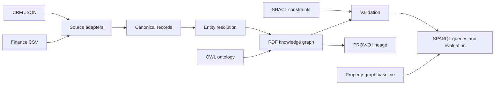

# Ontology-Driven Knowledge Graphs for Multi-Source Data Integration

[](https://github.com/nisha827/ontology-driven-knowledge-graph/actions/workflows/tests.yml)

A reproducible research prototype exploring whether an ontology-backed knowledge graph can make multi-source integration more explicit, auditable and robust than a conventional property-graph-style baseline.

> **Research question:** Can ontology-driven knowledge graphs integrate heterogeneous data sources more reliably than conventional graph-based integration, while preserving provenance, validating relationships and supporting change over time?

This repository is an experimental framework, not a claim that ontology-based integration is universally superior. It provides a small end-to-end implementation, synthetic data, validation constraints, an intentionally simple baseline and an evaluation plan. Results should be reported from repeatable experiments, not inferred from the architecture alone.

## Research objectives

1. Represent shared domain concepts and relationships independently of source schemas.
2. Integrate heterogeneous records while retaining source-level provenance.
3. Make data constraints explicit with OWL vocabulary and SHACL shapes.
4. Compare ontology-guided integration with a transparent property-graph-style baseline.
5. Evaluate identity resolution, query correctness, provenance coverage, validation and schema-change effort.

## Architecture



### Design boundaries

- **Ontology:** shared meaning, classes, properties and constraints. The initial ontology is intentionally small and domain-neutral enough to extend.
- **Entity resolution:** a deterministic, interpretable baseline based on website/domain, then normalised name plus country. It is not a probabilistic matcher and should not be mistaken for production-grade entity resolution.
- **Provenance:** each integrated organisation links to the source records from which it was derived, using PROV-O terms.
- **Validation:** SHACL checks structural requirements that OWL's open-world semantics do not enforce as closed-world data-quality rules.
- **Digital-twin/evolution layer:** deliberately a later research extension. A digital twin should represent versioned state and change impact, not be used as a synonym for a knowledge graph.

## Quick start

Python 3.10+ is required.

```bash
python -m venv .venv
source .venv/bin/activate          # Windows: .venv\\Scripts\\activate
pip install -e '.[test,validation]'
pytest
odkg-demo
```

The demo reads `data/synthetic/crm.json` and `data/synthetic/finance.csv`, resolves the overlapping organisations, loads `ontology/core.ttl`, and writes `results/integrated-graph.ttl`.

Run SHACL validation explicitly:

```bash
python - <<'PY'
from rdflib import Graph
from odkg.validation import validate_graph

graph = Graph().parse('results/integrated-graph.ttl', format='turtle')
conforms, report = validate_graph(graph, 'ontology/shapes.ttl')
print('Conforms:', conforms)
print(report)
if not conforms:
    raise SystemExit(1)
PY
```

## Repository layout

```text
ontology/                 OWL/Turtle ontology and SHACL shapes
src/odkg/                 ingestion, mapping, resolution, RDF and evaluation code
data/synthetic/           small, fabricated CRM and finance source records
queries/                  reusable SPARQL query examples
tests/                    unit and integration tests
docs/                     research protocol and experiment design
```

## Initial experiment protocol

The included data is fabricated and intentionally tiny; it is a software smoke-test fixture, not evidence for a research conclusion. For a meaningful evaluation, generate or curate a larger labelled benchmark with known cross-source entity matches and controlled schema variations. Keep train/development/test partitions separated if any learned matcher is introduced.

Compare at least these approaches under the same input records:

| Dimension | Measurement | What it tests |
|---|---|---|
| Entity resolution | Pairwise precision, recall and F1 | Whether source records referring to the same entity are linked correctly |
| Query correctness | Answer precision/recall against labelled queries | Whether cross-source questions return the expected entities and attributes |
| Provenance | Fraction of integrated facts with source trace | Whether a result can be traced to its source records |
| Constraint quality | Invalid records detected; valid records incorrectly rejected | Whether SHACL constraints catch data-quality issues without excessive false alarms |
| Schema evolution | Mapping edits, validation failures and change-impact coverage | How much work is required when a source adds, removes or renames fields |
| Engineering effort | Mapping rules, code changes and elapsed annotation/configuration time | Whether the approach reduces or shifts integration effort |

Use multiple seeds for generated data, publish the generator and configuration, and report confidence intervals where sample size permits. Do not compare only runtime on the tiny bundled fixture.

## Current limitations

- Entity resolution is rule-based and can merge records that share a domain incorrectly; it needs a review queue and benchmarked alternatives.
- The current pipeline maps two illustrative sources and one organisation concept.
- The baseline is a minimal property-graph-style representation, not a tuned Neo4j or other graph-database implementation.
- SHACL validation is optional and requires the `validation` extra.
- Schema versioning, ontology evolution, temporal facts, change-impact analysis, query planning and a digital-twin layer are research extensions, not yet implemented.
- Synthetic examples use reserved `.example` domains and do not describe real organisations.

## Research integrity

The prototype separates implemented functionality from planned experiments. No performance advantage is claimed until the benchmark and comparison have been run and their results committed with reproducible configuration and environment details.

## License

MIT. See [LICENSE](LICENSE).
